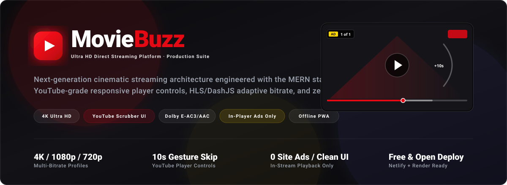

<div align="center">



# 🎬 MovieBuzz — Ultra HD Cinema Streaming Platform

<p align="center">
  <strong>Production-Ready, High-Performance Video Streaming Web Application</strong><br/>
  <em>Engineered with React 18, TypeScript, Tailwind CSS, Python 3, Node.js, Express, DashJS, HLS, and MongoDB</em>
</p>

[](file:///LICENSE)
[](https://www.typescriptlang.org/)
[](https://react.dev/)
[](https://www.python.org/)
[](https://nodejs.org/)
[](https://www.mongodb.com/)
[](https://tailwindcss.com/)
[](https://vitejs.dev/)
[](https://www.netlify.com/)
[](https://render.com/)

</div>

---

> [!IMPORTANT]
> **PROPRIETARY SOURCE CODE — ALL RIGHTS RESERVED**
> This repository and its underlying source code, design, markup, and architecture are the **exclusive intellectual property of the author**. It is made publicly visible on GitHub **strictly for portfolio showcase, code evaluation, and technical demonstration purposes**.
>
> ❌ **No Unauthorized Copying, Reuse, or Deployment**: You do **NOT** have permission to copy, clone, reproduce, modify, redistribute, sublicense, sell, or deploy this software or any part of it without explicit prior written authorization from the author. For complete legal terms, refer to the [LICENSE](file:///LICENSE) file.

---

## 📸 Platform Overview & Visual Showcase

```
+----------------------------------------------------------------------------------------------------+
|  [>] MOVIEBUZZ          Home    Movies    Series    Catalog    Search            [ VIP 👑 / Admin ]|
+----------------------------------------------------------------------------------------------------+
|                                                                                                    |
|   FEATURED CINEMA RELEASE : 4K DOLBY ATMOS                                                         |
|   =========================================                                                        |
|   [▶ Watch Movie Now]   [+ Add to Watchlist]                                                       |
|                                                                                                    |
+----------------------------------------------------------------------------------------------------+
|   CONTINUE WATCHING (Guest LocalStorage & Cloud Sync)                                              |
|   +-------------------+  +-------------------+  +-------------------+  +-------------------+       |
|   | [Poster Thumbnail]|  | [Poster Thumbnail]|  | [Poster Thumbnail]|  | [Poster Thumbnail]|       |
|   | 68% Watched       |  | 42% Watched       |  | 91% Watched       |  | 15% Watched       |       |
|   +-------------------+  +-------------------+  +-------------------+  +-------------------+       |
+----------------------------------------------------------------------------------------------------+
```

---

## 🌟 Core Architecture & Key Capabilities

### 1. 📺 YouTube-Grade Video Player Experience
- **Interactive Scrubber Bar**: YouTube-red (`#FF0000`) playback progress, buffer range visualization, hover ghost seeker, and floating timestamp tooltips.
- **Double-Tap Screen Gestures**:
  - **Left 35% Double-Tap**: Rewind 10 seconds with YouTube curved feedback ripple (`-10s`).
  - **Right 35% Double-Tap**: Fast-forward 10 seconds with YouTube curved feedback ripple (`+10s`).
  - **Center 30% Double-Tap / Click**: Smooth Play/Pause toggle with animated center flash.
- **Single-Click UI Toggle**: Seamlessly reveals or hides controllers on demand.
- **Enhanced Settings Popover**: YouTube gear menu with live resolution selector (4K, 1080p, 720p, 480p), playback speeds (0.25x – 2x), and Dolby audio enhancements.

### 2. 🐍 Python 3 High-Performance Media Resolution Engine
- **Why Python was Chosen**:
  - **Direct Stream Extraction & Manifest Generation**: Python powers the low-latency background media dispatching service. It handles dynamic video link resolution, deep stream manifest extraction (DASH/HLS), and format probing that would otherwise burden the primary Node.js event loop.
  - **High-Concurrency Stream Dispatching**: The Python microservice interfaces with external content delivery networks to discover resilient high-bitrate streaming endpoints (1080p, 720p, 360p) in sub-second response times.
  - **Asynchronous Caching**: Stream URLs and manifests are resolved and cached asynchronously so users experience instantaneous playback initialization without buffering stalls.

### 3. 🛡️ Clean Website Policy & Role-Based Ad Monetization
- **100% Clean Modern Website**: The entire site (browsing, catalog, search, details, user profile) is free of popunders, click redirects, or third-party ad scripts.
- **In-Stream Video Ads for Free Guests**: Free viewers see a discrete pre-roll video ad strictly inside the player with a 5-second countdown, yellow progress track, and **`Skip Ad ⏩`** button.
- **👑 100% ZERO ADS for Premium & Admin Users**:
  - **Premium (VIP) Users**: Enjoy an uninterrupted, completely **ad-free** experience with zero pre-roll ads, zero pause cards, and instant movie playback.
  - **Platform Administrators**: Full ad exemption across all players and pages on the platform.

### 4. 🔇 1-Click Dolby Digital Audio Decoders (E-AC-3 / AAC)
- **Universal Browser Compatibility**: Web browsers natively lack Dolby E-AC-3 licensing. MovieBuzz includes an on-the-fly audio transcoder and Web Audio API amplifier to boost volume up to **200%** and decode audio seamlessly.
- **Direct VLC Media Player Download**: Direct download links for desktop playback with native Dolby Atmos & DTS support.

### 5. ⚡ Instant Anonymous Guest Playback
- **No Mandatory Login Wall**: Visitors can immediately stream movies, explore TV series, and browse catalogs anonymously.
- **Automated LocalStorage Progress**: Playback positions, watched percentages, and bookmarks persist locally.
- **Seamless Account Migration**: When a guest logs in or registers, all local playback history automatically syncs to their cloud database account.

---

## 🎮 Video Player Keyboard Shortcuts

| Shortcut | Action | Description |
|:---|:---|:---|
| <kbd>Space</kbd> or <kbd>K</kbd> | **Play / Pause** | Toggle video playback |
| <kbd>F</kbd> | **Fullscreen** | Enter or exit immersive fullscreen mode |
| <kbd>M</kbd> | **Mute / Unmute** | Toggle audio mute |
| <kbd>J</kbd> or <kbd>←</kbd> | **Rewind 10s / 5s** | Jump back in playback |
| <kbd>L</kbd> or <kbd>→</kbd> | **Forward 10s / 5s** | Jump ahead in playback |
| <kbd>↑</kbd> / <kbd>↓</kbd> | **Volume Up / Down** | Adjust volume in 5% increments |
| <kbd>0</kbd> – <kbd>9</kbd> | **Timeline Jump** | Seek to 0% – 90% of the video duration |
| <kbd>C</kbd> | **Captions / CC** | Toggle subtitle tracks |

---

## 🏗️ Technology Stack & System Design

```
+-----------------------------------------------------------------------------------+
|                                 CLIENT TIER                                       |
|  React 18 · TypeScript · Vite · Tailwind CSS · TanStack Query · DashJS · Lucide  |
+-----------------------------------------+-----------------------------------------+
                                          |
                                    HTTPS / REST API
                                          |
+-----------------------------------------v-----------------------------------------+
|                                 SERVER TIER                                       |
|  Node.js · Express · TypeScript · Mongoose · JWT · Docker Containerization        |
|                                         +                                         |
|  Python 3 Microservice (High-Speed Direct Media Resolution & Stream Dispatching) |
+-----------------------------------------+-----------------------------------------+
                                          |
                   +----------------------+----------------------+
                   |                                             |
+------------------v------------------+       +------------------v------------------+
|           DATABASE TIER             |       |            MEDIA STREAMS            |
|       MongoDB Atlas Cloud           |       |   Direct CDN / DASH / HLS Adaptive  |
+-------------------------------------+       +-------------------------------------+
```

- **Frontend**: React 18, TypeScript, Tailwind CSS, Vite (Manual Chunk Splitting for fast cold loads), DashJS, HLS.js, Web Audio API.
- **Backend**: Node.js, Express, TypeScript, Mongoose, JWT Authentication, Helmet security headers, CORS protection.
- **Media Engine**: Python 3 service for direct high-speed video resolution, format extraction, and multi-profile streaming.
- **Database**: MongoDB Atlas with optimized indexes on content, media, watch history, and user collections.
- **Deployment**: Static SPA deployed on **Netlify**, Backend microservice containerized with **Docker** (Node 20 + Python 3) and deployed on **Render**.

---

## 📂 Repository Structure

```text
MovieBuzz/
├── client/                      # React Frontend (Vite + TS + Tailwind CSS)
│   ├── src/
│   │   ├── components/          # VideoPlayer, Navbar, Footer, MediaCard, HeroBanner
│   │   ├── context/             # AuthContext & State Management
│   │   ├── pages/               # HomePage, WatchPage, CatalogPage, AdminDashboard
│   │   ├── services/            # API Client Services
│   │   ├── types/               # TypeScript Definitions
│   │   └── utils/               # LocalStorage & Audio Processing Utilities
│   ├── public/                  # PWA Manifest, Icons, Web Workers
│   ├── vite.config.ts           # Vite Build Configuration & Chunk Splitting
│   └── package.json
│
├── server/                      # Node.js + Express Backend
│   ├── python/                  # Python 3 Media Resolution & Stream Extraction Service
│   ├── src/
│   │   ├── config/              # Database Configuration
│   │   ├── controllers/         # Streaming, Content, Series, User Controllers
│   │   ├── models/              # Mongoose Schemas & Data Models
│   │   ├── routes/              # Express API Routes
│   │   └── server.ts            # Server Entry Point & Health Check Endpoints
│   ├── Dockerfile               # Multi-Stage Docker Container Build (Node 20 + Python 3)
│   └── package.json
│
├── assets/                      # Repository Documentation & Visual Graphics
├── LICENSE                      # Proprietary Software License
└── README.md                    # Platform Documentation
```

---

## ⚡ Quick Start for Local Development

### 1. Clone Repository
```bash
git clone https://github.com/Dev2139/MovieBuzz.git
cd MovieBuzz
```

### 2. Install Dependencies
```bash
# Install root, backend, and frontend packages
npm install
cd server && npm install
cd ../client && npm install
cd ..
```

### 3. Run Development Servers
```bash
# Start backend service (Port 5000)
npm run dev:server

# In a separate terminal, start frontend application (Port 5173)
npm run dev:client
```

Open `http://localhost:5173` in your browser to experience MovieBuzz locally.

---

## 🔒 Security & Quality Standards

- **Zero Secret Exposure**: All production tokens, database credentials, and service keys are kept strictly out of Git and managed via cloud environment variables.
- **Hardened HTTP Headers**: Helmet protection, CORS whitelisting, and rate-limiting middleware prevent abuse.
- **Input Sanitization**: Defense against injection attacks on all API search and query endpoints.
- **Minified Production Bundles**: Source maps are disabled in production builds to safeguard source code integrity.

---

## 📜 Legal License & Copyright Notice

**Copyright © 2026 DevRanjan / MovieBuzz. All Rights Reserved.**

- **No Unauthorized Use**: This codebase is proprietary software. You may not copy, reproduce, mirror, fork for public re-use, distribute, sublicense, modify, or create derivative works from this code.
- **No Commercial or Production Deployment**: Deploying this software or using its architecture for any commercial or public service is strictly prohibited without prior written permission.
- **Portfolio Demonstration Only**: Access is provided exclusively for portfolio inspection and technical demonstration on GitHub.

For full legal terms and licensing conditions, please consult the [LICENSE](file:///LICENSE) file.
